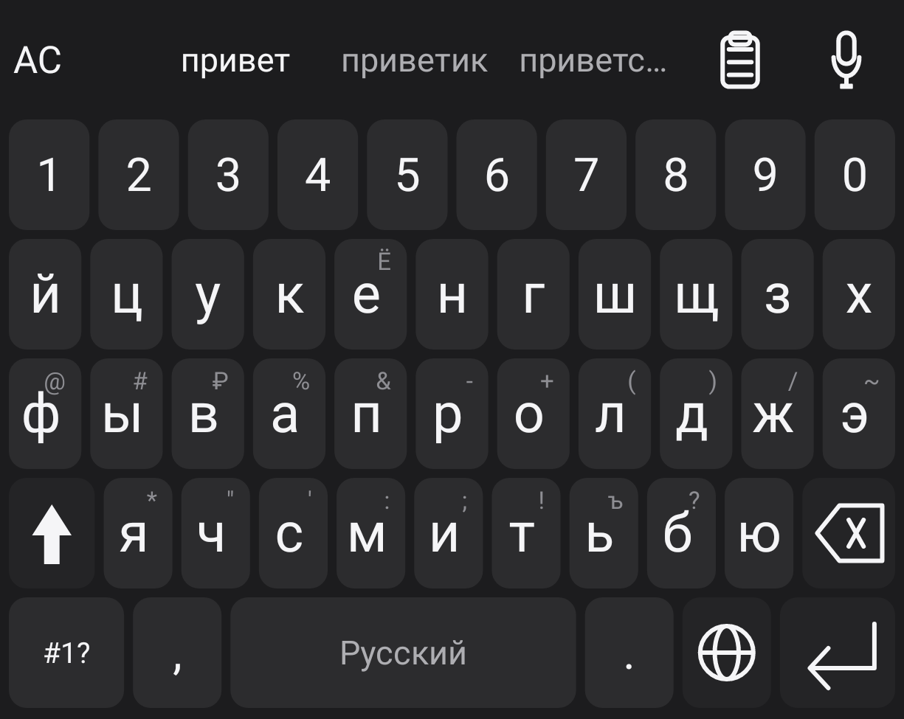
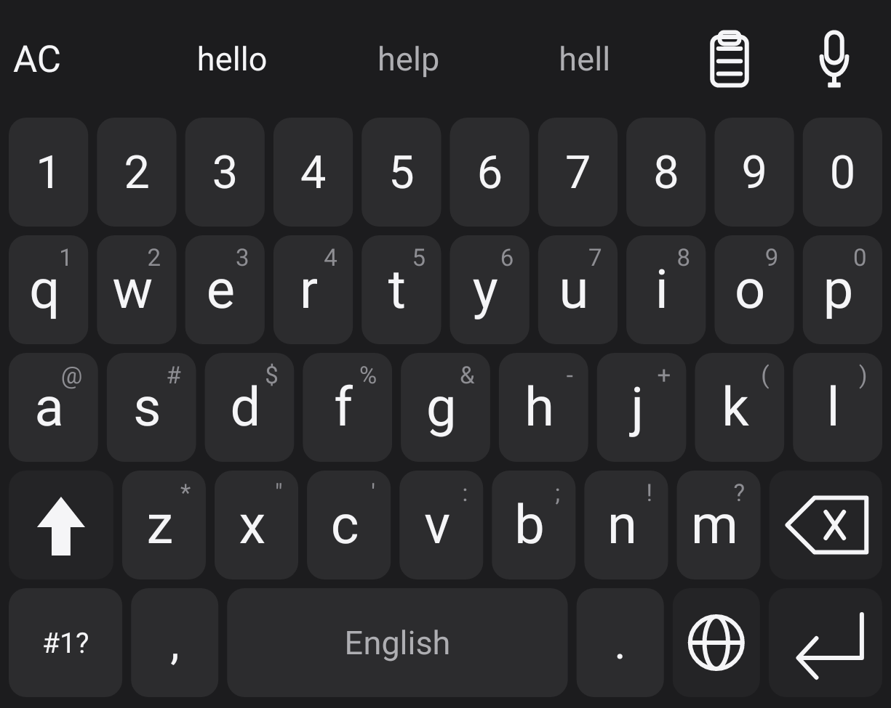
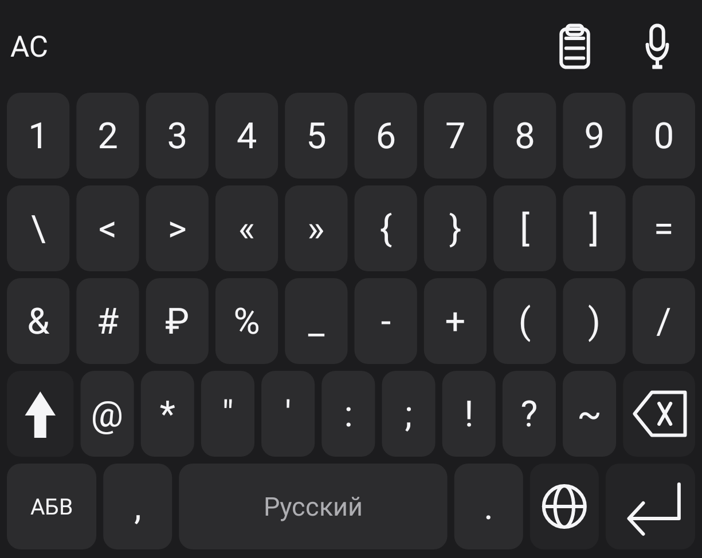
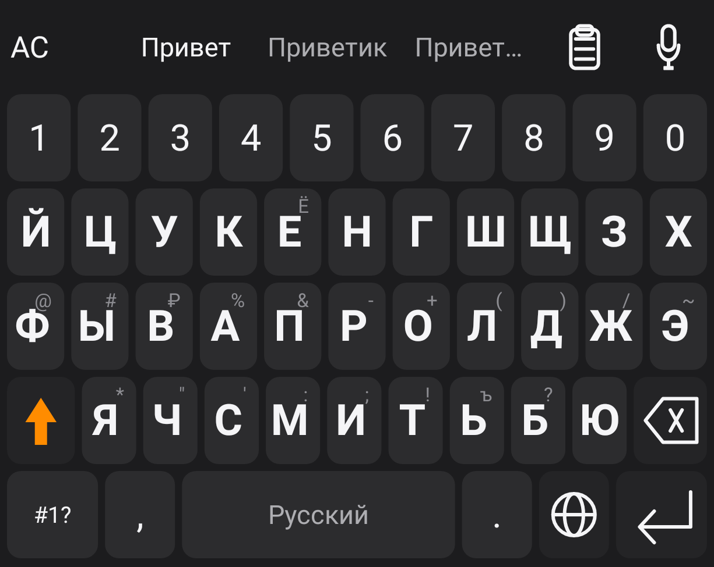
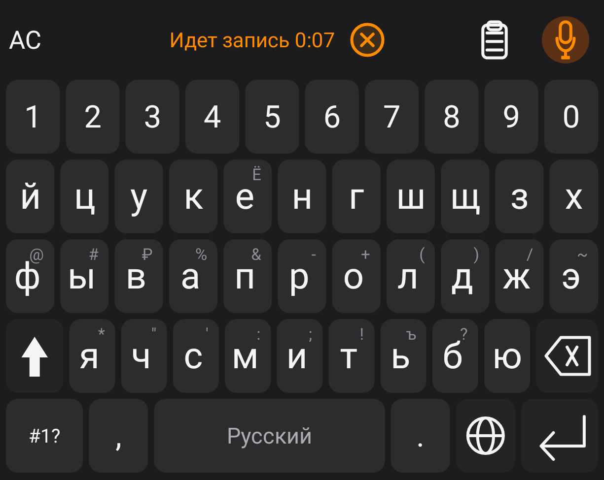
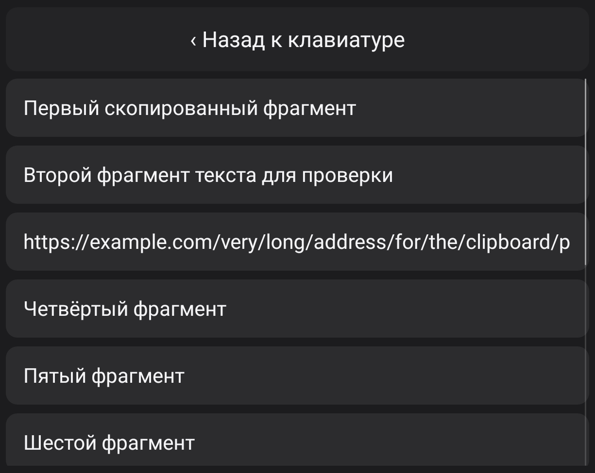
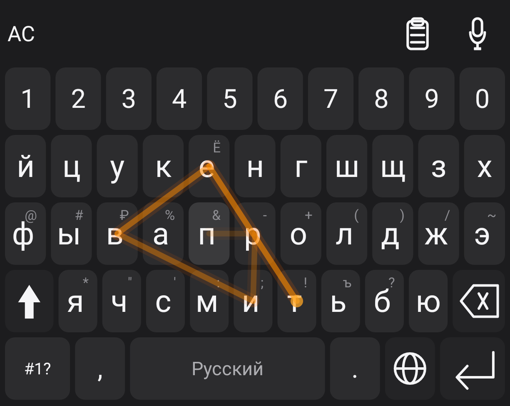

# VoiceBoard

Полноценная Android-клавиатура (IME) с русской и английской раскладками, обычным набором,
вводом слов **свайпом** (gesture typing), предиктивным вводом и голосовой диктовкой через
**Groq Whisper** + **DeepSeek**. Голосовой ввод остался прежним: запись 16 kHz mono → WAV →
распознавание → (опционально) оформление текста → вставка в активное поле через `InputConnection`.

Клавиатура нарисована на одном `Canvas`: собственные координаты клавиш, мультитач по `pointerId`
и единый сырой поток касаний. Свайп распознаётся геометрическим декодером (SHARK2-подобное
сравнение нормализованных траекторий + location/frequency-каналы), а не «сбором всех букв».

## Возможности

- Тёмная раскладка в стиле Яндекс.Клавиатуры: `#1C1C1E` подложка, `#2C2C2E` клавиши,
  `#242426` функциональные клавиши, оранжевый акцент `#FF8C00`.
- Русская **ЙЦУКЕН** и английская **QWERTY**, цифровой ряд, экран символов `#1?`.
- Второстепенные символы в правом верхнем углу клавиш и всплывающее превью при долгом нажатии.
- Мультитач rollover: вторая буква срабатывает мгновенно, пока первый палец ещё держит клавишу.
- Динамический регистр клавиш: строчные буквы обычного начертания в обычном режиме; при
  `Shift`/Caps Lock — заглавные того же кегля, но жирные, чтобы режим считывался сразу.
- Автозаглавные: первая буква в пустом поле и после `. ! ?`; ручной `Shift` отменяет автозаглавную.
- `Shift` (одна заглавная), двойной тап — **Caps Lock**. Caps Lock не сбрасывается при смене языка.
- Автопробелы по модели AOSP LatinIME/Gboard: слова и знаки не оставляют хвостовой пробел,
  а пробел ставится перед следующим словом (`PHANTOM`). Ручной пробел перед запятой/точкой
  убирается (`WEAK`), поэтому `слово ,` превращается в `слово,`.
- Виброотклик полностью отключён — ни клавиши, ни элементы верхней панели не вибрируют.
- Ввод слов свайпом с затухающим оранжевым шлейфом, топ-1 словом сразу в поле и тремя
  альтернативами в панели Т9. Пробел между свайп-словами появляется ровно один; знаки
  `...`, `?!`, `)))` можно вводить слитно.
- Удвоенные буквы и эквивалентность `е`/`ё` учитываются при построении эталонного пути.
- Горизонтальный свайп по пробелу двигает курсор пропорционально смещению пальца.
- `AC` очищает активное поле; долгое нажатие `AC` открывает настройки VoiceBoard.
- Буфер обмена: панель с историей до 20 записей за сессию, прокруткой, вставкой по тапу
  и кнопкой возврата.
- Т9: до трёх частотных подсказок в верхней панели, тап заменяет недописанное слово;
  следующий ввод автоматически отделяется пробелом.
- Микрофон в верхней панели без подложки, в классическом стиле (капсула, U-дужка, ножка,
  основание); во время записи/распознавания вокруг пульсирует оранжевый ореол.
- Во время записи панель показывает «Идет запись» и кнопку-крестик: она мгновенно отменяет
  запись/обработку без вставки текста.
- Долгое нажатие `⌫` — сначала быстрое удаление, затем удаление целыми словами.
- Долгое нажатие `🌐` — системный выбор клавиатуры.

## Внешний вид

Скриншоты — это реальный Canvas, отрисованный Robolectric-тестом `KeyboardCanvasRenderTest`
(не макеты). Вторичные символы рисуются мелким шрифтом в правом верхнем углу клавиши.

| Русская раскладка | Английская раскладка | Экран символов |
|---|---|---|
|  |  |  |
| **Shift: заглавные, тот же кегль** | **Запись: «Идет запись» и отмена** | **Буфер обмена с прокруткой** |
|  |  |  |
| **Свайп слова «привет»** |  |  |
|  |  |  |

Референсные макеты, с которых снималась раскладка, лежат в `docs/reference/`.

## Голосовой ввод

1. Тап по микрофону — начинается запись (16 kHz mono PCM → WAV в `cacheDir`).
2. Повторный тап — запись останавливается, файл уходит в `api.groq.com` на распознавание.
3. Если включён DeepSeek — текст отправляется в `api.deepseek.com` для пунктуации и регистра.
4. Результат вставляется через `InputConnection.commitText()`.

Пока идёт запись, микрофон пульсирует оранжевым ореолом, а в центральной части верхней панели
показывается оранжевая надпись «Идет запись» и кнопка `×` в круге. Тап по `×` мгновенно
прерывает запись или уже начатую обработку: аудио и запоздалый ответ API отбрасываются,
текст в поле не вставляется. На время распознавания и оформления экран не гаснет
(`FLAG_KEEP_SCREEN_ON` + `PARTIAL_WAKE_LOCK`).

Если ключ Groq или разрешение на микрофон не заданы, клавиатура показывает ошибку и открывает
настройки. При ошибке DeepSeek в поле всё равно вставляется сырой текст Whisper, а причина
показывается в статусе и Toast.

## Ввод свайпом

- Свайп запускается, только если палец начал на буквенной клавише, прошёл системный touch slop
  и посетил хотя бы одну другую буквенную клавишу. Короткий тап, мультитач-набор, свайп по
  пробелу для курсора и экран символов работают как раньше.
- След пальца живёт в реальном времени: точки старше 200 мс удаляются и плавно теряют яркость,
  активный хвост ограничен 128 точками, а отрисовка обновляется каждые ~16 мс. Длинная или
  запутанная траектория больше не превращается в «узел» и не ждёт `ACTION_UP`.
- Путь пальца ресемплится в 32 точки. Для каждого слова-кандидата строится ломаная по центрам
  клавиш; подряд идущие одинаковые буквы схлопываются (`класс` → `клас`), а `ё` при построении
  пути приравнивается к `е`. Затем сравниваются нормализованная форма кривой, положение начала
  и конца и частотность словоформы.
- `InputRouter` сохраняет historical-точки `MotionEvent` и время каждого сэмпла. Декодер
  использует эту скорость/замедление, кривизну, Gaussian-вероятности прохождения около центров
  клавиш, строгие якоря старта/финиша и prior на длину слова.
- Финальный shape-score считается banded DTW с весами первых/последних точек и медленных
  участков; mean-distance остаётся дешёвым prefilter, поэтому DTW выполняется только для
  top-N кандидатов, а не для всего first/last-бакета.
- Полный перебор 150 000 словоформ не выполняется: словарь индексируется по первой/последней
  букве (с учётом соседних клавиш), поэтому на тестовых фразах декодирование занимает ~7 мс
  на JVM даже без оптимизаций под конкретное устройство.
- Топ-1 слово сразу вставляется в поле, а в панели Т9 остаются три лучших кандидата. Тап по
  альтернативе заменяет вставленное слово.
- Слова и знаки препинания не оставляют хвостовой пробел. Состояние `PHANTOM` означает, что
  следующий подходящий токен получит пробел перед собой: `слово` + свайп → `слово слово`.
  Поэтому в конце текста не остаётся висящего пробела, а `...`, `?!`, `)))` вводятся слитно.
- Прилипающие знаки `. , ! ? : ; … ) ] } »` никогда не получают пробел перед собой. Если перед
  знаком был ручной пробел (`WEAK`), он удаляется: `слово ,` → `слово,`, затем следующее слово
  снова отделяется пробелом.
- Открывающие знаки `( [ { «` отделяются от предыдущего слова, но текст внутри группы
  прилипает к знаку: `слово (текст)`.
- Одиночный `Shift` делает первую букву заглавной; `Caps Lock` вставляет слово целиком
  заглавными и остаётся включённым.
- Одиночный `Backspace` сразу после свайпа удаляет всё введённое слово и добавленный перед ним
  пробел. После паузы или ручной правки работает обычное посимвольное удаление.
- В полях паролей и чисел (`EditorInfo`), а также на экране символов `#1?` свайп автоматически
  отключается; автопробелы дополнительно выключаются в e-mail, URI и числовых полях.

## Т9

- `app/src/main/assets/ru_dict.tsv` — 150 000 самых частотных русских словоформ.
- `app/src/main/assets/en_dict.tsv` — 50 000 английских слов.
- Словари загружаются в фоне при создании сервиса и строятся в компактное префиксное дерево
  на массивах (≈390k узлов на оба языка). В каждом узле хранятся три самых частотных слова
  поддерева, поэтому подсказка — это один проход по префиксу.
- Ранжирование по частоте; при нехватке точных продолжений добавляется коррекция опечаток
  по соседним клавишам раскладки (замена одной буквы), включая позиции внутри слова.
- Тап по подсказке удаляет набранный хвост слова и вставляет подсказку; следующий ввод
  автоматически отделяется пробелом (хвостовой пробел не добавляется).

Пересобрать словари можно скриптом:

```bash
python tools/prepare_dictionaries.py ru_full.txt app/src/main/assets/ru_dict.tsv --limit 150000 --language ru
python tools/prepare_dictionaries.py en_full.txt app/src/main/assets/en_dict.tsv --limit 50000  --language en
```

Исходники частотных корпусов — [hermitdave/FrequencyWords](https://github.com/hermitdave/FrequencyWords).

## Клавиши и жесты

| Клавиша | Тап | Долгое нажатие |
|---|---|---|
| Буква | буква с учётом Shift/Caps | второстепенный символ с превью |
| Буквы (свайп по клавишам) | слово топ-1 + 3 альтернативы в Т9 | — |
| `⌫` | удалить символ | автоповтор → удаление словами |
| `⇧` | одна заглавная / переключение | — |
| `⇧` дважды | Caps Lock (повторный тап выключает) | — |
| `Пробел` | пробел | свайп влево/вправо — курсор |
| `#1?` / `АБВ` | экран символов / обратно к буквам | — |
| `🌐` | русский ↔ English (Caps Lock сохраняется) | системный список клавиатур |
| `↵` | перенос строки или действие поля (поиск/отправить) | — |
| `AC` | очистить поле | настройки VoiceBoard |
| Микрофон | старт / стоп диктовки | — |
| Буфер обмена | открыть историю | — |

Клавиатура поддерживает мультитач: каждая клавиша обрабатывается по `pointerId`, поэтому при
быстрой печати второе нажатие не теряется, пока первый палец ещё не отпущен.

## Сборка APK на GitHub

`.github/workflows/build.yml` собирает debug-APK при каждом пуше в любую ветку.

```bash
git init
git add .
git commit -m "VoiceBoard: keyboard with voice input"
git branch -M main
git remote add origin https://github.com/<логин>/<репозиторий>.git
git push -u origin main
```

Готовый APK — во вкладке **Actions → последний запуск → Artifacts → VoiceBoard-apk**.

Чтобы получить APK ещё и в разделе Releases, пушните тег:

```bash
git tag v1.0 && git push origin v1.0
```

APK подписан отладочным ключом — устанавливается как обычно, но потребуется разрешить
установку из неизвестных источников. Обновление поверх релизного (по-другому подписанного)
APK работать не будет.

### Gradle wrapper

`gradlew` в репозитории нет: `gradle-wrapper.jar` — бинарник. CI ставит Gradle 8.7 сам
(`gradle/actions/setup-gradle`), Android Studio сгенерирует wrapper при первом открытии проекта.
Локально из консоли — установите Gradle 8.7+ и JDK 17, затем `gradle assembleDebug`.

Тесты клавиатуры (Robolectric + JUnit, без эмулятора): `gradle testDebugUnitTest`. Они проверяют
геометрию, тапы, мультитач, долгое нажатие, свайп по пробелу, запуск/отключение gesture typing,
правила `AutoSpacingManager` (`NONE`/`PHANTOM`/`WEAK`, все сценарии со свайпом и пунктуацией),
регистр/Backspace (`SwipeTextPolicy`), правила автозаглавных (`AutoCapPolicy`), кликабельность
кнопки отмены записи, TTL следа, передачу временных меток в свайп и точность распознавания на
27 русских и английских словах (`SwipeRecognitionTest`), включая шумовой набор с jitter,
overshoot и переменной скоростью.

## Первый запуск

1. Установите APK и откройте приложение VoiceBoard.
2. **Включить VoiceBoard в системе** → отметьте VoiceBoard в списке клавиатур.
3. **Выбрать VoiceBoard как клавиатуру** → выберите её в переключателе.
4. **Разрешить доступ к микрофону** — обязательно: `InputMethodService` не может запросить
   разрешение сам, только приложение.
5. Вставьте ключи Groq (`gsk_…`) и DeepSeek (`sk-…`), нажмите **Проверить ключи**.

Ключи лежат в `EncryptedSharedPreferences` на устройстве и уходят только на `api.groq.com`
и `api.deepseek.com`.

## Настройки

| Параметр | По умолчанию | Зачем |
|---|---|---|
| Модель Groq | `whisper-large-v3-turbo` | быстрее и дешевле `whisper-large-v3`, точность чуть ниже |
| Модель DeepSeek | `deepseek-chat` | |
| Оформлять через DeepSeek | вкл | +1–3 с к задержке; при ошибке вставится сырой текст Whisper |
| Язык распознавания | авто | явный `ru` заметно снижает шанс, что Whisper переключится на другой язык |
| Автоматический пробел | вкл | пробел перед вставкой, если курсор стоит вплотную к слову |
| Промпт | см. настройки | системный промпт для DeepSeek (`role: "system"`) |

Кнопка **Проверить ключи** для Groq делает пинг `/models`, а для DeepSeek прогоняет через
`chat/completions` тестовую фразу без пунктуации с текущим промптом и показывает результат.
Это единственный способ убедиться, что промпт реально работает: `/models` у DeepSeek отвечает
`200` даже при нулевом балансе.

Если DeepSeek не отработал, клавиатура всё равно вставит текст Whisper, но напишет причину
в статусе и Toast. Это относится и к явным ошибкам (сеть, пустой ключ), и к случаю, когда
DeepSeek ответил `200`, но результат не похож на причёсанный текст: слишком длинный/короткий
относительно исходной расшифровки, начинается со вступления вроде «вот исправленный текст»,
содержит markdown-разметку или упоминает себя как языковую модель. Такой ответ отбрасывается,
в поле уходит текст Whisper.

## Архитектура

```
app/src/main/java/com/voiceboard/
  VoiceKeyboardService.kt   IME: обработка клавиш, T9-состояние, вставка текста, буфер обмена
  KeyboardCanvasView.kt     одна Canvas-поверхность: раскладки, геометрия RectF, отрисовка, мультитач, шлейф
  InputRouter.kt            сырые трассы пальцев + детекция свайпа по touch slop и посещённым клавишам
  SwipeEngine.kt            SwipeLayout/SwipeLexicon, mean-distance prefilter и weighted DTW-декодер
  SwipeGesture.kt           путь свайпа + временные метки для velocity/dwell
  SwipeTextPolicy.kt        регистр свайп-слова и удаление свайпнутого слова
  AutoSpacingManager.kt     PHANTOM/WEAK-автопробелы (слова, пунктуация, скобки, числовые поля)
  AutoCapPolicy.kt          допустимые поля и пунктуация для автозаглавных
  PredictionEngine.kt       компактный Trie, частотное ранжирование, коррекция опечаток, индекс для свайпа
  VoiceInputController.kt   изолированный голосовой ввод (запись → Groq → DeepSeek → commitText)
  AudioRecorder.kt          AudioRecord → WAV + уровень сигнала
  SpeechApi.kt              Groq Whisper и DeepSeek поверх OkHttp
  Prefs.kt                  EncryptedSharedPreferences с откатом на обычные
  SettingsActivity.kt       ключи, модели, переключатели, проверка ключей
app/src/main/assets/
  ru_dict.tsv, en_dict.tsv  частотные словари для Т9
```

Клавиатура не использует `Button`/`OnClickListener`: `KeyboardCanvasView` хранит карту клавиш
(`RectF` + центральная точка), сам обрабатывает `ACTION_DOWN/POINTER_DOWN/MOVE/UP`, а
`InputRouter` получает все события и копию карты клавиш. Свайп сохраняет снимок геометрии на
момент касания, поэтому смена языка/символов другим пальцем не ломает декодирование.
`InputRouter.SwipeSink` отдаёт путь и снимок в `SwipeEngine`, который работает на
`Dispatchers.Default`; отрисовка шлейфа остаётся на UI-потоке.

## Ограничения

- Максимальная длительность одной диктовки — 3 минуты, дальше запись останавливается сама.
- Распознавание сетевое: без интернета клавиатура покажет ошибку.
- Доступ к микрофону из IME разрешён системой активной клавиатуре, но отдельные прошивки
  (в основном китайские) режут его агрессивным энергосбережением — тогда в статусе появится
  сообщение от `AudioRecord`.
- Агрессивные производители (Xiaomi/Huawei/Samsung и их battery-менеджеры) могут всё равно
  прибить фоновый процесс клавиатуры вопреки wake lock — это системное ограничение прошивки.
- Свайп работает по подключённым частотным словарям: очень редкие или отсутствующие словоформы
  не распознаются, а во время начальной загрузки словаря показывается статус. Персональное
  обучение и добавление своих слов пока не реализованы.
- В полях паролей/чисел и на экране символов gesture typing отключён намеренно.

minSdk 26 · targetSdk 34 · Kotlin 1.9.24 · AGP 8.5.2 · JDK 17
